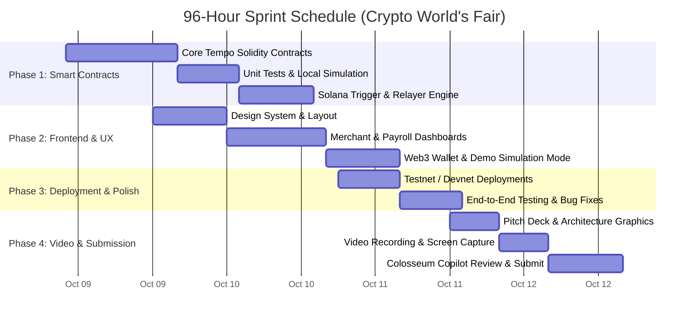

# ⏱️ 96-Hour Execution & Submission Playbook: The Path to the Podium

> **Target Deadline**: October 12, 2026 at 11:59 PM PT  
> **Current Date**: October 8, 2026  
> **Total Time Remaining**: ~96 Hours  
> **Goal**: Flawless execution, zero wasted cycles, winning pitch video, and 100% compliant submission on Colosseum Arena.

---

## 1. Hour-by-Hour Execution Roadmap (Oct 8 – Oct 12)

---

### Day 1 (Oct 8 – Oct 9): Core Contracts & Protocol Logic
- **Goal**: Have all smart contracts written, compiled, and unit-tested.
- **Tasks**:
  1. Initialize Foundry/Hardhat project for Tempo L1 smart contracts (`TempoFlowRouter.sol`, `TempoPayrollStream.sol`).
  2. Implement mock Enshrined AMM interface and mock stablecoins (USDC/EURC) for seamless testing.
  3. Write Anchor program for Solana cross-chain ingress (`tempo_crosschain_ingress`).
  4. Run Foundry test suite to achieve 100% green test passing with gas benchmarks.

### Day 2 (Oct 9 – Oct 10): Frontend Web3 Application
- **Goal**: Build a stunning, Apple/Stripe-grade Web application.
- **Tasks**:
  1. Build Next.js / Vite web app with sleek dark-mode glassmorphic aesthetics.
  2. Implement **Merchant Terminal**: Instant QR code generation, incoming transaction stream with sound effects and animated receipts.
  3. Implement **Payroll Portal**: Live ticking odometer showing salary streaming per second, with 1-click withdraw.
  4. Build the **"One-Click Judge Demo Mode"**: Allow judges to toggle "Simulate Customer Payment" or "Fund Payroll Stream" with pre-funded wallets so they never get stuck on external faucets!

### Day 3 (Oct 10 – Oct 11): Deployment & Relayer Integration
- **Goal**: Live on-chain deployments and verified block explorers.
- **Tasks**:
  1. Deploy contracts to Tempo Testnet and Solana Devnet.
  2. Connect the frontend to live contract addresses and verify all transactions on block explorers.
  3. Record transaction hashes for inclusion in the README and submission form.
  4. Run rigorous cross-browser testing to guarantee zero console errors.

### Day 4 (Oct 11 – Oct 12): Pitch Video, Copilot Audit & Final Submission
- **Goal**: Record an irresistible 3-minute video and submit early before server congestion.
- **Tasks**:
  1. Record pitch video using the script below (screen recording + high-energy voiceover).
  2. Edit video into clean 1080p, upload to YouTube (unlisted or public) and Loom.
  3. Structure the GitHub repository with detailed README, badges, architecture diagrams, and license (MIT).
  4. Submit to **Colosseum Copilot** AI inside the Arena to audit score and address any flagged weaknesses.
  5. Submit project to **Colosseum Arena** at least 6 hours before the 11:59 PM PT deadline!

---

## 2. Word-for-Word 3-Minute Winning Pitch Video Script

> **Time Target**: Exactly 2 minutes 45 seconds (under the 3:00 hard ceiling).  
> **Visual Rule**: Never spend more than 30 seconds on slides. 70% of the video must be live, working product demo!

---

### [0:00 - 0:30] The Hook & The Problem
*(Visual: Clean slide showing the fragmented stablecoin payment landscape, then zoom into the "Gas Token Tax" and "Network Congestion" pain points)*

> **Speaker**:  
> "Stablecoins settle trillions of dollars every quarter. Yet for the average consumer and global business, crypto payments remain fundamentally broken.  
> If you want to pay a merchant twenty dollars in USDC, you are forced to bridge and hold volatile gas tokens just to submit the transaction. And during high-traffic market surges, payments stall while gas fees skyrocket.  
> Today, that changes. Welcome to **TempoFlow**—the sub-second programmable stablecoin payment and streaming payroll highway, powered natively by Tempo L1 and bridged directly to Solana retail liquidity."

---

### [0:30 - 1:15] The Core Innovation (Why Tempo + Solana)
*(Visual: Architecture diagram transitioning into the live Web3 Dashboard)*

> **Speaker**:  
> "TempoFlow leverages the unique architecture of the new Tempo blockchain, incubated by Stripe and Paradigm.  
> First: **Stablecoin-Native Gas**. There are no gas tokens in TempoFlow. Every transaction fee is paid directly in USDC or EURC at a fraction of a cent.  
> Second: **Sub-Second Dedicated Payment Lanes**. While other chains choke during volatility, Tempo guarantees zero-congestion, zero-slippage settlement in under six hundred milliseconds.  
> Third: **Cross-Chain Ingress from Solana**. Shoppers pay with one click from their Phantom wallet or Solana Blink, and funds settle instantly into the merchant's Tempo treasury."

---

### [1:15 - 2:05] The Live Product Demo (The "Aha!" Moment)
*(Visual: Screen recording showing two split windows: Customer on the left, Merchant on the right)*

> **Speaker**:  
> "Let’s see it in action.  
> On the right is our Merchant Terminal. The merchant needs fifty EURC for an international order.  
> On the left, our customer pays using USDC on Solana. With one single tap—watch the screen.  
> *[Click happens. Sound effect chimes. Green checkmark flashes. Receipt appears on merchant screen in 0.6 seconds.]*  
> Done. In under one second, the transaction bridged, routed through Tempo's Enshrined AMM, converted USDC to EURC, and settled in the merchant's vault.  
> Now let’s look at **Continuous Streaming Payroll**.  
> Employers deposit monthly contractor salaries into our streaming vault. Watch the employee dashboard: the contractor's salary ticks up by fractions of a cent every second. The employee can withdraw their earned wages anytime, completely gasless. No waiting two weeks for a paycheck."

---

### [2:05 - 2:35] Market Size & Business Model
*(Visual: Slide showing TAM and Revenue Engine)*

> **Speaker**:  
> "The market opportunity is staggering. Global cross-border payments exceed forty trillion dollars annually.  
> TempoFlow monetizes via a clean ten basis points protocol settlement fee—a fraction of traditional card networks’ three percent swipe fees—along with five basis points on Enshrined FX swaps.  
> At just one hundred million in monthly volume, TempoFlow generates one point eight million in high-margin annualized protocol revenue."

---

### [2:35 - 2:45] The Ask & Vision
*(Visual: Team slide with GitHub, live demo link, and Colosseum Accelerator logo)*

> **Speaker**:  
> "Our smart contracts are deployed, fully tested, and open-source. Try the live demo right now at the link below.  
> We are building the permanent settlement infrastructure for the internet economy, and we are ready to scale with the Colosseum Accelerator.  
> Thank you."

---

## 3. Colosseum Arena Submission Form Template

Copy and adapt these exact answers when completing your submission on `arena.colosseum.org`:

### 1. Project Name
`TempoFlow` (or `AegisPay`)

### 2. Elevator Pitch (One Sentence)
> "The sub-second programmable stablecoin highway: enabling gasless merchant checkout, streaming continuous payroll, and enshrined FX swaps on Tempo L1 with instant cross-chain ingress from Solana."

### 3. Track Selection
- **Primary Ecosystem Track**: `Tempo ($100,000)`
- **Global Category Track**: `Payments & Stablecoins`
- **Secondary Ecosystem Track**: `Solana ($100,000)`
- **Special Awards Checked**: `Public Goods Award ($10,000)`

### 4. Problem Statement
> Traditional blockchain payments fail real-world commerce due to volatile gas token requirements, unpredictable confirmation latencies during network congestion, and high currency slippage on cross-border payments. Businesses cannot run retail POS or payroll when a $20 payment requires $5 in gas fees or takes 30 seconds to confirm.

### 5. Detailed Solution & Integration
> TempoFlow utilizes Tempo's native EVM primitives to solve every payment friction point:
> 1. **Zero Gas Tokens**: Users pay gas directly in USDC/EURC via Tempo’s native fee abstraction.
> 2. **Dedicated Payment Lanes**: Sub-second (0.6s) deterministic settlement ensuring payment speeds competitive with Visa.
> 3. **Enshrined AMM FX**: Instant conversion between USD, EUR, and regional stablecoins at the validator layer with near-zero slippage.
> 4. **Solana Ingress**: Retail consumers initiate payments from Solana wallets (Phantom/Blinks), seamlessly routing into Tempo settlement vaults.
> 5. **Continuous Payroll**: Smart contracts stream stablecoin salaries by the second, allowing global workers instant access to earned wages.

### 6. Technical Stack
- **Smart Contracts**: Solidity ^0.8.24 (Tempo L1), Rust / Anchor (Solana Devnet)
- **Frontend**: Next.js 15, TypeScript, Tailwind CSS, Lucide Icons, Canvas Confetti
- **Web3 Libraries**: Ethers.js / Viem, @solana/web3.js, @solana/wallet-adapter
- **Testing & Tooling**: Foundry (Forge), Anchor Test, GitHub Actions CI/CD

### 7. Traction & Live Demo Links
- **Live Interactive Web App**: `https://tempoflow.xyz` (or Vercel deployment link)
- **GitHub Repository**: `https://github.com/[your-username]/tempoflow`
- **Tempo Explorer Contract**: `0x...` (Verified contract link)
- **Solana Devnet Program**: `TempoF1owIngress...`

---

## 4. Colosseum Copilot Optimization Checklist

Before final submission, use the **Colosseum Copilot** AI tool on the Arena to audit your project draft:
- [ ] **Check 1: Working Live Link**: Verify that your live demo URL loads without basic 404 or wallet crashes.
- [ ] **Check 2: Public GitHub Repo**: Ensure the repository is Public and contains a detailed `README.md` with setup instructions and test outputs.
- [ ] **Check 3: Clean Video Link**: Ensure the YouTube video is either Unlisted or Public, has HD processing finished, and has working audio.
- [ ] **Check 4: Address Copilot Prompts**: If Copilot suggests expanding on "Distribution Strategy" or "Go-To-Market", add your B2B pilot pipeline (e.g. onboarding 5 Web3 native DAOs and freelancer agencies in Q4).

---

## 5. Submission Final Checklist (The "No Disqualification" Guarantee)
1. **Never submit in the last 15 minutes**: The Colosseum Arena servers experience heavy traffic spikes near the deadline. Submit at least 2–4 hours early.
2. **Double check all wallet addresses**: Ensure your team payout address is a valid non-custodial wallet (Phantom / MetaMask) that you control.
3. **Open-Source License**: Ensure your repo has an `LICENSE` file (MIT or Apache-2.0) to be eligible for the Public Goods award.
