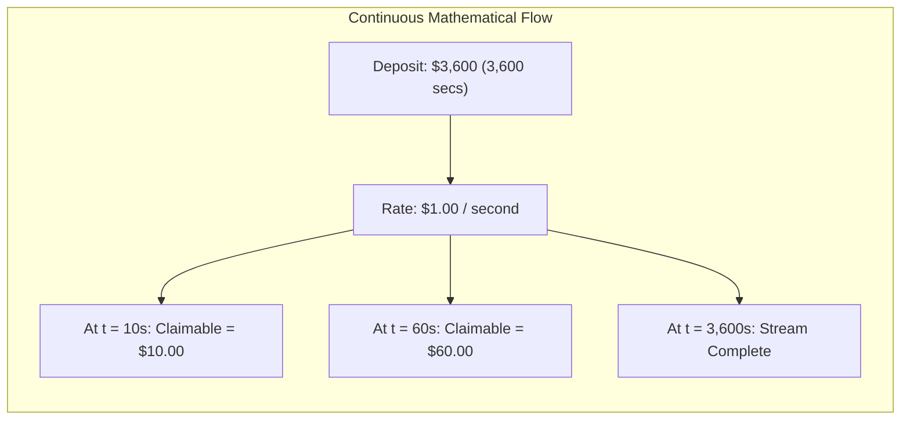

# 📖 TempoFlow: The Master Terminology & Technical Primer

> **Purpose**: A comprehensive, authoritative breakdown of every Web3, cryptographic, and financial engineering concept powering **TempoFlow**.  
> **Audience**: Hackathon founders, judges, and investors. Master these concepts to defend your project with absolute technical authority during Q&A and pitch reviews.

---

## 1. Core Blockchain & Layer-1 Primitives

### 1. Stablecoin-Native Gas (Fee Abstraction)
* **What it is**: The ability of a blockchain to accept fiat-pegged stablecoins (like USDC, EURC) directly as the payment token for transaction gas fees, completely removing the requirement for a volatile native cryptocurrency (like ETH or SOL).
* **How it works on Tempo L1**: In standard EVM networks, the virtual machine requires `msg.value` denominated in the native gas asset. Tempo modifies the transaction execution engine: validators accept USDC directly, and an enshrined mechanism settles validator rewards automatically.
* **Why it matters**: It completely eliminates the **"Gas Token Tax"**. A consumer holding $50 in USDC can make purchases immediately without first acquiring, bridging, and calculating volatile gas tokens.

---

### 2. Dedicated Payment Lanes
* **What it is**: A network-level transaction routing mechanism that separates high-priority, latency-sensitive commercial payment transactions from speculative, compute-heavy transactions (such as NFT mints or complex DeFi liquidations).
* **How it works**: Transactions flagged with payment opcodes or interacting with registered payment vaults enter dedicated validation queues that guarantee sub-second (0.6s) deterministic block inclusion.
* **Why it matters**: On standard blockchains, when a popular memecoin or NFT launches, gas prices spike 100x and block times degrade. Payment lanes guarantee that a customer buying coffee or an employer streaming payroll experiences the exact same $0.001 fee and 0.6s confirmation speed regardless of market volatility.

---

### 3. Enshrined AMM (Automated Market Maker)
* **What it is**: An automated exchange protocol built directly into the core blockchain consensus layer (protocol precompile) rather than deployed as an isolated third-party smart contract (like Uniswap V3 or Raydium).
* **How it works in TempoFlow**: When a buyer pays in USDC but an international merchant requires EURC, the `TempoFlowRouter` calls the native validator precompile:
  $$\text{EnshrinedAMM.swapExactTokensForTokens}(amountIn, minOut, USDC, EURC, merchant)$$
* **Why it matters**:
  - **Zero Protocol Fee Overhead**: Bypasses typical 0.30% third-party DEX LP fees.
  - **MEV Immunity**: Because the swap occurs inside the protocol precompile during block production, sandwich bots and toxic front-runners cannot front-run or sandwich the currency exchange.
  - **Instant Settlement**: Currency conversion and merchant vault crediting happen in a single atomic transaction.

---

### 4. Machine Payments Protocol (MPP)
* **What it is**: An open payment standard co-authored by **Stripe and Tempo** designed specifically for autonomous AI agents, machine-to-machine micro-transactions, and automated recurring API billing.
* **How it works in TempoFlow**: AI agents (such as automated data scrapers, LLM inference bots, or autonomous procurement systems) can open micro-streams that pay per compute cycle or per byte transferred, settling continuously on Tempo L1 without manual human approvals.

---

## 2. Mathematical & Algorithmic Primitives

### 5. Continuous Streaming Mathematics ($O(1)$ Complexity)
* **The Problem**: If an employer wants to pay a contractor every second, executing a smart contract transaction every second would generate 86,400 transactions per day, costing tens of thousands of dollars in gas and spamming the blockchain.
* **The Solution: Linear Delta Interpolation**:
  Instead of executing discrete transactions, the smart contract stores three fixed variables:
  - $\text{StartTime}$ ($t_0$)
  - $\text{StopTime}$ ($t_1$)
  - $\text{DepositAmount}$ ($D$)
* **The Formula**:
  $$\text{Rate per Second } (R) = \frac{D}{t_1 - t_0}$$
  $$\text{Available Claimable Balance at time } t = \min\left(D, \, (t - \text{LastClaimTime}) \times R\right)$$
* **Why it is revolutionary**: The stream flows continuously in mathematical time without consuming a single drop of gas. Gas is only consumed when the employee decides to withdraw funds ($O(1)$ constant time complexity).

---

## 3. Cross-Chain & Interoperability Primitives

### 6. Solana Ingress & Cross-Chain Intents
* **What it is**: An architecture that allows retail consumers on Solana (using Phantom or Solflare) to initiate payments without switching wallets, bridging tokens, or understanding Tempo L1.
* **How it works**:
  1. The user approves an SPL-Token transfer to a non-custodial Solana Anchor vault (`tempo_crosschain_ingress`).
  2. The program emits a cryptographically signed `CrossChainPaymentIntent` event.
  3. The TempoFlow decentralized relayer detects the finalized Solana block and calls `TempoFlowRouter.executePayment()` on Tempo L1 within 1.5 seconds.
* **Why it matters**: 95% of active crypto retail users keep their capital in Solana wallets. Solana ingress allows merchants on Tempo to tap into billions of dollars in Solana retail liquidity with zero friction.

---

### 7. Solana Actions & Blinks (Blockchain Links)
* **What it is**: An open Solana protocol standard that converts any on-chain transaction into a shareable URL metadata frame (a "Blink").
* **How it works**: When a merchant shares a TempoFlow invoice link on X (Twitter), Telegram, or Discord, the platform unfurls an interactive payment button inside the social feed.
* **Why it matters**: A buyer can click "Pay 50 USDC" directly inside an X post, and the funds route immediately through the TempoFlow ingress pipeline to the merchant.

---

## 4. Privacy & Compliance Primitives

### 8. ZK Viewing Keys & Compliance "Zones"
* **What it is**: Cryptographic credentials that allow a user or enterprise to generate selective read-only proofs of on-chain transactions without revealing their private spending keys or exposing balances publicly.
* **How it works in TempoFlow**:
  - Employee payroll streams are shielded using Zero-Knowledge proofs.
  - When the employer files corporate taxes or the employee files personal income taxes, the contract exports an official **Cryptographic Audit Certificate** decryptable only with the authorized auditor's Viewing Key.
* **Why it matters**: Solves the biggest obstacle to corporate crypto adoption: enterprises will never use public ledgers if competitors or employees can inspect their entire payroll spreadsheet on Etherscan.

---

## 5. Financial & Protocol Terms

### 9. Basis Points (bps)
* **Definition**: A unit of measurement equal to $\frac{1}{100}\text{ of } 1\%$ ($0.01\%$).
* **TempoFlow Application**:
  - Protocol Settlement Fee: **10 bps** ($0.10\%$). If a merchant receives $1,000$, TempoFlow collects $1.00$. (Traditional credit cards charge 250–350 bps / $2.5\% - 3.5\%$).
  - Enshrined FX Fee: **5 bps** ($0.05\%$).

---

### 10. Non-Custodial Smart Contract Escrow
* **Definition**: A smart contract architecture where neither TempoFlow, nor any administrator, nor any third party ever possesses or can seize user deposits.
* **TempoFlow Application**: Funds are locked deterministically in bytecode logic. Only the designated merchant, employee, or depositor (in the event of a cancellation) can trigger fund releases.
