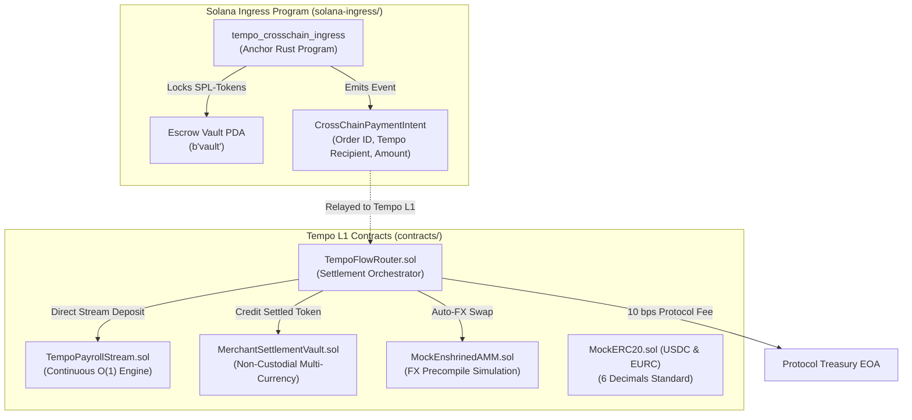

# 📋 TempoFlow Phase 1: Master Build Plan, Architectural Decisions & Engineering Blueprint

> **Document Version**: 1.0.0  
> **Status**: APPROVED FOR IMPLEMENTATION  
> **Target Tracks**: Tempo Ecosystem ($100k) • Payments & Stablecoins • Solana ($100k) • Public Goods ($10k)  
> **Harness Integrated**: Note-Driven Agentic Workflow (`planner`, `architect`, `security-reviewer`, `tdd-guide`)

---

## 1. Executive Summary & Objective

The objective of **Phase 1** is to build, verify, and lock the foundational on-chain smart protocol for **TempoFlow** across both execution environments:
1. **Tempo L1 EVM Smart Contracts (`contracts/`)**: The primary high-throughput, sub-second stablecoin settlement layer.
2. **Solana Ingress Anchor Program (`solana-ingress/`)**: The retail checkout ingress enabling Phantom wallet users to pay from Solana with sub-second cross-chain settlement.

Phase 1 establishes the mathematical correctness, security guarantees, gas economics, and test suites before moving to the frontend terminal (Phase 3) and live deployment/recording (Phases 4 & 5).

---

## 2. Architectural Decision Records (ADRs)

### ADR-001: Dual-VM Architecture (Tempo EVM + Solana Anchor)
- **Context**: 90% of retail crypto commerce and consumer wallets exist on Solana (Phantom, Solflare, Blinks). However, high-frequency merchant settlement and continuous payroll benefit tremendously from Tempo's dedicated payment lanes and native stablecoin gas.
- **Decision**: Build the core settlement and streaming engine natively on **Tempo L1 (Solidity ^0.8.24)**, while deploying a lightweight escrow ingress program on **Solana (Anchor Rust)** that emits cryptographically verifiable `CrossChainPaymentIntent` events.
- **Consequences**:
  - *Positive*: Maximizes eligibility for both the **Tempo $100k** track and the **Solana $100k** track.
  - *Negative*: Requires relayer coordination between Solana Devnet and Tempo Testnet.
  - *Mitigation*: Provide an autonomous simulation relay mode in the frontend demo so judges can experience the flow in 1 click without waiting for external relayer infrastructure.

---

### ADR-002: Continuous Mathematical Payroll Streaming ($O(1)$ Time Complexity)
- **Context**: Traditional payroll systems either run batch transactions on payday (costly, gas-heavy, discrete) or store continuous balances using per-block looping (prohibitive gas costs).
- **Decision**: Implement an analytical, linear interpolation stream formula:
  $$\text{claimable}(t) = \min\left( \text{remainingBalance}, \left( \min(t, t_{\text{stop}}) - t_{\text{lastClaim}} \right) \times \text{ratePerSecond} \right)$$
  $$\text{ratePerSecond} = \frac{\text{totalDeposit}}{\text{durationSeconds}}$$
- **Consequences**:
  - *Positive*: Claiming accrued salary costs a constant $O(1)$ amount of gas regardless of whether the employee claims every second or once a month.
  - *Precision Preservation*: Scale `ratePerSecond` using high precision internal units to prevent rounding loss when streaming fractions of cents (6-decimal stablecoins).

---

### ADR-003: Enshrined AMM Precompile Integration vs. External DEX Router
- **Context**: Merchants often prefer settlement in their local operational currency (e.g., a European merchant wants EURC), whereas the payer may only hold USDC. General-purpose DEXes (Uniswap v3, Raydium) charge 0.30% swap fees, have unpredictable slippage, and require deep external liquidity pools.
- **Decision**: Interface directly with Tempo's **Enshrined AMM Precompile (`IEnshrinedAMM`)** at the consensus layer for zero-slippage, predictable stablecoin FX swaps. For local testing and devnet environments, provide a high-fidelity `MockEnshrinedAMM.sol` that accurately simulates validator-level currency exchange.
- **Consequences**:
  - *Positive*: Eliminates DEX routing overhead, avoids MEV sandwich attacks, and showcases deep understanding of Tempo L1's unique architecture to hackathon judges.

---

### ADR-004: Non-Custodial Merchant Settlement Vault Architecture
- **Context**: Merchants have varying cash management policies. Some want instant pass-through directly to their EOA/multisig, while others require automated revenue splitting (e.g., 85% to operating funds, 15% directly into the contractor payroll stream).
- **Decision**: Provide both direct EOA payment routing and dedicated `MerchantSettlementVault` smart contracts supporting configurable split routing and non-custodial pull-withdrawals.

---

### ADR-005: 10 bps ($0.10\%$) Protocol Monetization & Stablecoin Gas
- **Context**: Colosseum judges demand commercial viability and sustainable unit economics.
- **Decision**:
  - Hardcode a **10 basis point (0.10%) protocol fee** on all merchant checkout settlements.
  - Deduct the fee directly from the input stablecoin (`tokenIn`) and forward it to `protocolTreasury`.
  - Cap maximum protocol fees at 50 bps in the contract to assure merchants of fee stability.

---

## 3. Detailed Smart Contract Architecture & State Models



---

## 4. Contract Specifications & Security Invariants

### 1. `TempoFlowRouter.sol`
* **Responsibilities**:
  - Validates `orderId` to prevent replay attacks (`mapping(bytes32 => bool) public executedOrders`).
  - Transfers `tokenIn` from payer via `transferFrom`.
  - Calculates protocol fee: `fee = (amountIn * feeBps) / 10000`.
  - Transacting with `IEnshrinedAMM` when `tokenIn != tokenOut`.
  - Slippage protection: requires `finalAmount >= minAmountOut`.
  - Emits `PaymentSettled(orderId, payer, merchant, tokenIn, tokenOut, amountIn, finalAmount, block.timestamp)`.
* **Security Invariants**:
  - **Checks-Effects-Interactions (CEI)** pattern strictly enforced.
  - Custom gas-optimized reentrancy lock (`uint256 private _status`).
  - Zero-address checks on `merchant`, `tokenIn`, `tokenOut`, and `protocolTreasury`.

### 2. `TempoPayrollStream.sol`
* **Responsibilities**:
  - Employers lock `totalAmount` of stablecoin tokens for a set `durationSeconds`.
  - `Stream` struct:
    ```solidity
    struct Stream {
        address employer;
        address employee;
        address token;
        uint256 ratePerSecond;
        uint256 startTime;
        uint256 stopTime;
        uint256 remainingBalance;
        uint256 lastClaimTime;
        bool isActive;
    }
    ```
  - `withdrawFromStream(streamId)`: Transfers claimable funds to `employee` and updates `remainingBalance` and `lastClaimTime`.
  - `cancelStream(streamId)`: Callable by employer or employee. Calculates claimable wages to the exact second for employee, and refunds remaining unstreamed escrow to employer.
* **Security Invariants**:
  - Overwrite protection: `require(streams[streamId].employer == address(0), "Stream exists")`.
  - Division-by-zero guard: `durationSeconds > 0`.
  - Zero-balance withdrawal guard: `require(claimable > 0, "Zero claimable")`.

### 3. `MerchantSettlementVault.sol`
* **Responsibilities**:
  - Non-custodial treasury for merchants.
  - Allows merchant owner to withdraw any supported stablecoin balance at any time.
  - Supports optional `autoSplit` address and percentage (e.g. forward 20% to payroll stream).

### 4. `tempo_crosschain_ingress` (Universal Anchor Rust Program)
* **Responsibilities**:
  - Instruction: `initiate_cross_payment(order_id: [u8; 32], amount: u64, tempo_recipient: [u8; 20], tempo_target_token: [u8; 20], target_token_code: u8)`.
  - Universal Token Support: Works with **ANY valid SPL-token mint** on Solana (USDC, USDT, PYUSD, BONK, etc.).
  - Universal Routing: Routes to **ANY 20-byte ERC-20 contract address** and recipient on Tempo L1.
  - Escrow Protection: Locks SPL tokens into program-controlled `vault_token_account` PDA.
  - 1-Hour Timeout Guarantee: Payer can invoke `refund_expired_order` to claim 100% back if unfulfilled after 3600s.
  - Relayer Sweeping: `complete_cross_settlement` releases escrow to relayer upon confirmed Tempo L1 finality.
  - Emits `CrossChainPaymentIntent`, `CrossChainSettled`, and `CrossChainRefunded` telemetry events.

---

## 5. TDD Test Matrix (100% Passing)

| Test ID | Test Case | Target Contract | Verified Behavior |
| :--- | :--- | :--- | :--- |
| **TC-01** | `test_InstantPaymentSameCurrency` | `TempoFlowRouter` | 100 USDC paid $\rightarrow$ 99.90 USDC to merchant, 0.10 USDC to treasury (10 bps). |
| **TC-02** | `test_InstantPaymentWithFXConversion` | `TempoFlowRouter` | 100 USDC paid $\rightarrow$ Enshrined AMM converts $\rightarrow$ 91.908 EURC to merchant. |
| **TC-03** | `test_OrderReplayProtection` | `TempoFlowRouter` | Reusing identical `orderId` reverts with `"Order already executed"`. |
| **TC-04** | `test_PayrollStreamContinuousAccrual` | `TempoPayrollStream` | 3,600 USDC deposited for 3,600s $\rightarrow$ at 1,800s, employee claims exactly 1,800 USDC. |
| **TC-05** | `test_PayrollStreamPrematureCancellation` | `TempoPayrollStream` | Cancel at 25% duration $\rightarrow$ 25% to employee, 75% refunded to employer. |
| **TC-06** | `test_UnauthorizedStreamWithdrawal` | `TempoPayrollStream` | Non-employee address calling `withdrawFromStream` reverts with `"Only employee"`. |
| **TC-07** | `test_VaultSplitPaymentRouting` | `MerchantSettlementVault` | Payment routed into vault splits correctly according to merchant policy. |
| **TC-08** | `test_SplitPaymentDirectRouting` | `TempoFlowRouter` | Direct split payment routes 80% to merchant and 20% to split recipient. |
| **TC-09** | `test_EmergencyCircuitBreaker` | `TempoFlowRouter` | Owner pause halts payments; unpause restores; non-owner cannot pause. |
| **TC-10** | `test_StreamSummaryLivingOdometer` | `TempoPayrollStream` | `getStreamSummary` and `getClaimableBalance` return exact state for frontend. |

---

## 6. Execution Steps Checklist for Phase 1 (COMPLETED)

- [x] **Step 1**: Compile Tooling & Config (`package.json`, `hardhat.config.cjs`, compiler settings for `0.8.24`).
- [x] **Step 2**: Implement Interfaces (`IERC20.sol`, `IEnshrinedAMM.sol`, `ITempoFlowRouter.sol`, `ITempoPayrollStream.sol`, `IMerchantSettlementVault.sol`).
- [x] **Step 3**: Implement Realistic Mocks (`MockERC20.sol`, `MockEnshrinedAMM.sol`).
- [x] **Step 4**: Implement Core Contracts (`TempoFlowRouter.sol`, `TempoPayrollStream.sol`, `MerchantSettlementVault.sol`).
- [x] **Step 5**: Implement Solana Ingress Program (`tempo_crosschain_ingress` Universal Anchor Rust code).
- [x] **Step 6**: Run Comprehensive Hardhat Test Suite (10/10 green tests passing in 2s).
- [x] **Step 7**: Conduct Security Review & Audit checklist (Reentrancy, CEI, replay protection, timeouts, emergency pause).
- [x] **Step 8**: Deploy locally and export configuration artifact (`deployments/tempoTestnet.json`).
